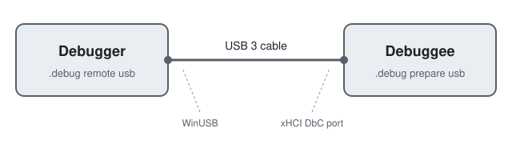
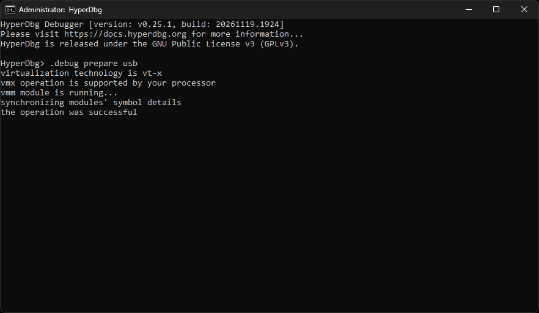
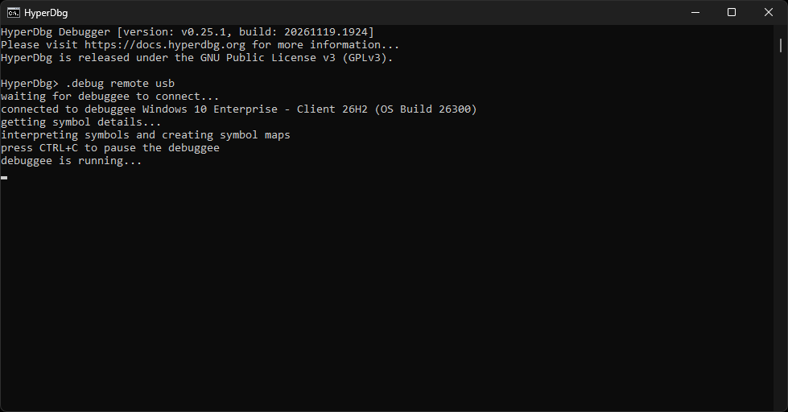
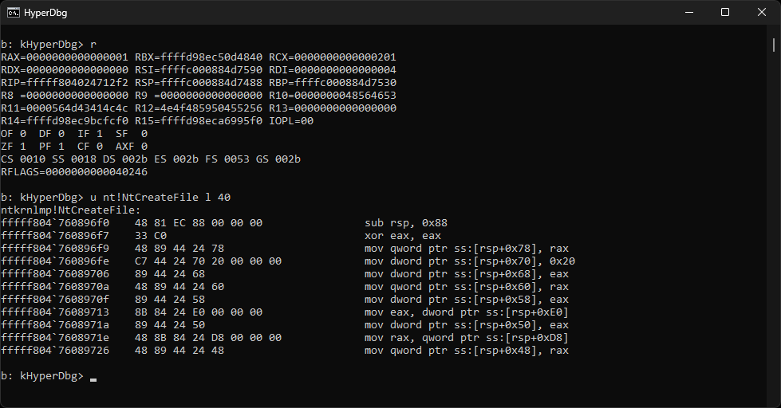
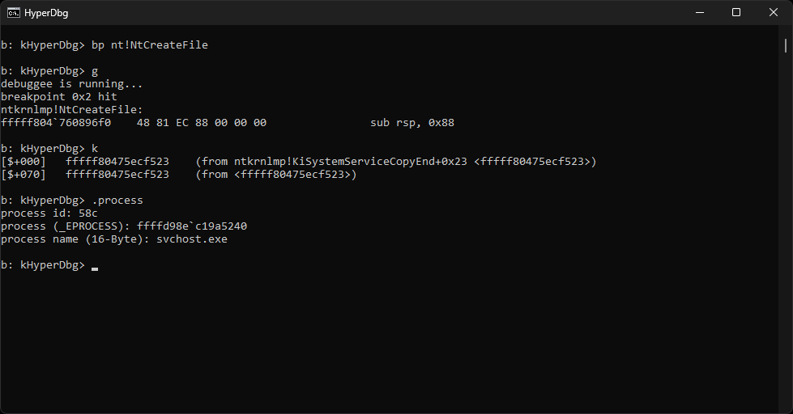

<div align="center">

<h1>HyperDbg</h1>
<p width="120">  A HyperDbg fork with support for debugging over a USB 3.0 cable using the Intel xHCI Debug Capability Interface (DBC) </p>
</div>

----

<p align="left">
<a href="https://docs.hyperdbg.org"></a>
<a href="https://www.gnu.org/licenses/gpl-3.0"></a>
</p>

## Description

**HyperDbg** is an open-source, hypervisor-assisted debugger for **Windows**. In the **Debugger Mode**, **HyperDbg** debugs a remote computer (the **debuggee**) from another computer (the **debugger**), which the original project connects over a serial cable or a named pipe.

This fork adds a **USB 3.0** connection. On the debuggee, **HyperDbg** uses the **Debug Capability (DbC)** of the xHCI USB controller, the same hardware that Windows uses for USB 3.0 kernel debugging, and on the debugger, it uses Microsoft's **WinUSB** driver.

<p align="center"></p>

For the general usage of **HyperDbg**, refer to the **[HyperDbg documentation](https://docs.hyperdbg.org)**.

This fork also includes fixes for **HyperDbg** itself that are needed to debug a physical computer. They apply to both serial and USB connections and are available separately in the [hyperdbg-core-fixes](https://github.com/lava1879/HyperDbg/tree/hyperdbg-core-fixes) branch.

## Requirements

### Debugger

- A computer that runs 64-bit **Windows**.
- A USB 3.0 port on an xHCI host controller. The port on the debugger does not need to support debugging.

### Debuggee

- An Intel processor with **VT-x** and **EPT**, with VT-x enabled in the firmware (BIOS/UEFI).
- An xHCI host controller that supports debugging, and a USB 3.0 port on that controller that is debug capable. Not every port on a host controller supports debugging, so check the ports as described in **[Find the debug port](#find-the-debug-port)**.
- The usual **HyperDbg** requirements for the debuggee, as described in **[Build & Install](https://docs.hyperdbg.org/getting-started/build-and-install)**.

### Cable

An orange Microsoft USB debug cable is highly recommended. This is an A-A crossover cable that has two male type-A plugs and no Vbus connection, and it is available from vendors such as [DataPro - USB 3.0 Super-Speed A/A Debugging Cable](https://www.datapro.net/products/usb-3-0-super-speed-a-a-debugging-cable.html).

However, I personally developed this fork using a [Meta Quest Link Cable](https://www.meta.com/quest/accessories/link-cable/), with a [UGREEN USB to USB C 3.2 10Gbps Type C to Type A Adapter](https://www.ugreen.com/en-au/products/au-45275) on the debugger's side.

To simplify the troubleshooting, connect the cable directly between the debuggee and the debugger, avoiding any hubs or docking stations.

## Build & Installation

Clone this repository with the `--recursive` flag.
```
git clone --recursive https://github.com/lava1879/HyperDbg.git
```
Build and install **HyperDbg** as described in **[Build & Install](https://docs.hyperdbg.org/getting-started/build-and-install)**, and use the same build on both computers.

### Install the WinUSB driver on the debugger

The debugger needs the WinUSB driver package for the debug device, which you only need to install once.

1. Open **PowerShell** as administrator.
2. Go to the root folder of this repository, which contains `hyperdbg-usb.inf` and `hyperdbg-usb-install.ps1`.
3. Run:
   ```
   Set-ExecutionPolicy -Scope Process Bypass
   .\hyperdbg-usb-install.ps1
   ```

To remove the driver package, run:
```
.\hyperdbg-usb-install.ps1 -Uninstall
```

## Prepare the debuggee

### Find the debug port

To find a port that supports debugging, use **USBView**, which is included in [Debugging Tools for Windows](https://learn.microsoft.com/en-us/windows-hardware/drivers/debugger/).

1. On the debuggee, start **USBView**.
2. In **USBView**, expand the nodes of the xHCI host controllers, and look for an indication that a port on the host controller supports debugging. A port that you can use shows **Is Port Debug Capable: yes** and **USB 3.0: yes**, as in the following example:
   ```
   [Port15]

   Is Port User Connectable:         yes
   Is Port Debug Capable:            yes
   Companion Port Number:            2
   Companion Hub Symbolic Link Name: USB#ROOT_HUB30#4&23178b3&0&0#{f18a0e88-c30c-11d0-8815-00a0c906bed8}
   Protocols Supported:
    USB 1.1:                         no
    USB 2.0:                         no
    USB 3.0:                         yes

   ConnectionStatus:      NoDeviceConnected
   ```
3. Make a note of the port number. In this example, the port number is 15.
4. To find the physical connector of that port, plug a USB 3.0 device, such as a flash drive, into a connector on the debuggee and refresh **USBView**. If the device appears under the port number from step 3, connect the cable to that connector. Otherwise, try another connector.

Each physical connector has a USB 2.0 port and a USB 3.0 port, which **USBView** lists as companion ports. The debug connection always uses the USB 3.0 port.

### Disable power management

Windows can turn off an idle USB controller to save power, which drops the connection.

1. On the debuggee, open **Device Manager**.
2. Under **Universal Serial Bus controllers**, open the properties of the xHCI controller that has the debug port.
3. On the **Power Management** tab, clear **Allow the computer to turn off this device to save power**.
4. Do the same for the **USB Root Hub (USB 3.0)** of that controller.

### Turn off Windows USB kernel debugging

**HyperDbg** cannot use the debug port while Windows' own USB kernel debugger ([KDUSB](https://learn.microsoft.com/en-us/windows-hardware/drivers/debugger/setting-up-a-usb-3-0-debug-cable-connection) or [KDNET-USB](https://learn.microsoft.com/en-us/windows-hardware/drivers/debugger/setting-up-a-kdnet-usb-connection)) owns it. If you used one of them on the debuggee, open **Command Prompt** as administrator on the debuggee, run the following command, and then restart the debuggee:
```
bcdedit /debug off
```

## Starting a debugging session for the first time

1. Connect the cable to a USB 3.0 port on the debugger and to the debug port on the debuggee.
2. On the debugger, start **HyperDbg** and run the following command, or `.debug remote pause usb` to pause the debuggee as soon as it connects:
   ```
   HyperDbg> .debug remote usb
   ```
3. On the debuggee, start **HyperDbg** and run:
   ```
   HyperDbg> .debug prepare usb
   ```
   
4. On the debugger, open **Device Manager**. Under **Universal Serial Bus devices**, you see **USB 3.0 Debug Cable**, and on its **Driver** tab, the **HyperDbg USB Debug** driver. If the device has a yellow mark, see **[Troubleshooting](#troubleshooting)**.

When the connection is ready, the debugger shows the name of the debuggee's operating system:



## Starting a debugging session

After the first time, the WinUSB driver stays installed. Connect the cable, run `.debug remote usb` on the debugger, and run `.debug prepare usb` on the debuggee.

You can start either computer first. If you start the debuggee first, it waits up to 60 seconds for the debugger and shows:
```
HyperDbg> .debug prepare usb
is the debugger listening? retry handshaking with the debugger... (timeout: 5 seconds)
```

To end the session, run `.debug close` on the debugger. The debuggee unloads **HyperDbg**, and you can start a new session without restarting it.

## Examples

After the debugger connects, all **HyperDbg** commands work over the USB connection. The following example shows the registers of the paused debuggee and the disassembly of `nt!NtCreateFile`:



The following example sets a breakpoint on `nt!NtCreateFile`, continues the debuggee until the breakpoint is hit, and shows the call stack:



## Commands

| Computer | Command | Description |
| --- | --- | --- |
| Debugger | `.debug remote usb` | Connect to a debuggee over USB |
| Debugger | `.debug remote pause usb` | Connect to a debuggee over USB and pause it |
| Debuggee | `.debug prepare usb` | Prepare this computer to be debugged over USB |
| Debugger | `.debug close` | Close the connection |

For the rest of the `.debug` command, see **[.debug](https://docs.hyperdbg.org/commands/meta-commands/.debug)**.

This fork also adds the USB connection to the **[SDK](https://docs.hyperdbg.org/using-hyperdbg/sdk)**:
```c
BOOLEAN hyperdbg_u_connect_remote_debugger_using_usb(BOOLEAN pause_after_connection);
BOOLEAN hyperdbg_u_connect_current_debugger_using_usb();
```

## Troubleshooting

### The debuggee shows "USB debugging is not ready"

```
Err, USB debugging is not ready
err, unable to read the USB handshake
```
The debugger did not detect the debuggee over the cable. Make sure that the cable is connected to the debug port on the debuggee (see **[Find the debug port](#find-the-debug-port)**), that the cable and both ports support USB 3.0, and that Windows USB kernel debugging is off on the debuggee.

If the debuggee has Intel **Direct Connect Interface (DCI)** enabled, turn it off in the firmware settings, since its USB mode uses the same debug hardware.

### The debuggee shows "no USB reply"

```
err, no USB reply in 60 seconds.
Run '.debug remote usb' on the debugger. Then retry '.debug prepare usb'.
```
Run `.debug remote usb` on the debugger, and then run `.debug prepare usb` on the debuggee again.

### The debugger shows "WinUSB is not set for the USB debug device"

```
err, WinUSB is not set for the USB debug device: <error name>, <error code>.
Run hyperdbg-usb-install.ps1 from the HyperDbg source folder.
```
The WinUSB driver is not installed for the debug device. Install it as described in **[Install the WinUSB driver on the debugger](#install-the-winusb-driver-on-the-debugger)**, and then unplug and reconnect the cable.

### The debugger shows "USB device not recognized"

If Windows shows a **USB device not recognized** notification on the debugger when you connect the cable, or **Device Manager** shows **The USB device returned an invalid USB BOS descriptor** (Code 43), you are likely hitting a known USB 3.1 to USB 3.1 compatibility issue. This issue affects connections between a USB 3.1 controller on the debugger and an Intel Ice Lake or Tiger Lake USB 3.1 controller on the debuggee.

To work around this issue, open **Command Prompt** as administrator on the debugger, run the following command, and then unplug and reconnect the cable:
```
reg add HKLM\SYSTEM\CurrentControlSet\Control\usbflags\0525127A0000 /v SkipBOSDescriptorQuery /t REG_DWORD /d 1 /f
```
For more information, see [USB device not recognized](https://learn.microsoft.com/en-us/windows-hardware/drivers/debugger/setting-up-a-usb-3-0-debug-cable-connection#usb-device-not-recognized).

### The port stops working after the debuggee restarts or hangs

Unplug the cable from the debugger and plug it back in.

## Contributing

Contributions to this fork are welcome.

For contributions to the original **HyperDbg** project, please read its [Contribution Guide](https://github.com/HyperDbg/HyperDbg/blob/master/CONTRIBUTING.md).

## License

**HyperDbg**, and all its submodules and repos, unless a license is otherwise specified, are licensed under **GPLv3** LICENSE.

Dependencies are licensed by their own.
